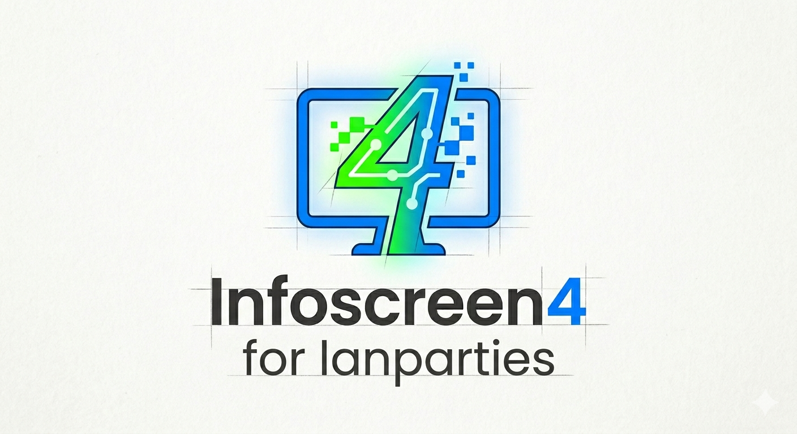

# Infoscreen4
{: .fs-9 }

A real-time infoscreen system for LAN parties. Build slides in the browser and publish them to any number of screens from one admin view.
{: .fs-6 .fw-300 }

[Get started](getting-started/installation){: .btn .btn-primary .fs-5 .mb-4 .mb-md-0 .mr-2 }
[View on GitHub](https://github.com/reaby/infoscreen4){: .btn .fs-5 .mb-4 .mb-md-0 }

---

## What it does

Infoscreen4 runs as one Node.js server on your LAN. Each screen opens a browser page (`/display/<id>`). An operator uses `/admin` to decide what each screen shows. Updates reach the screens instantly over WebSockets, with no page reloads.

| Feature | Description |
|:--|:--|
| **Real-time sync** | Slide changes, announcements and streams reach displays instantly via Socket.IO. |
| **Multiple displays** | Each display plays its own bundle, and you control each one separately. |
| **Bundles** | Ordered playlists of slides with shared background, size, duration and transitions. |
| **Visual editor** | Fabric.js editor for text, images, videos, shapes and colors. |
| **Slide types** | Editor slides, full-screen videos, and embedded websites. |
| **Scheduling** | Limit slides to a date range or a daily time window. |
| **Announcements** | Lower-third overlay messages for one display or all of them. |
| **Live streaming** | Share a camera or screen from `/send` to any display over WebRTC. |
| **No database** | All content is plain JSON and media files under `data/`. |

## Where to go next

- [Installation](getting-started/installation): run Infoscreen4 with Node.js, Docker or PM2.
- [Configuration](getting-started/configuration): environment variables, HTTPS and the data directory.
- [Admin guide](guide/admin): displays, bundles, playback and announcements.
- [Slide editor](guide/editor): build slides and learn the keyboard shortcuts.
- [Security](reference/security): **read this before exposing the server beyond a trusted LAN.**

## Tech stack

Next.js 16 · React 19 · Socket.IO 4 · Fabric.js 7 · Tailwind CSS 4 · TypeScript
